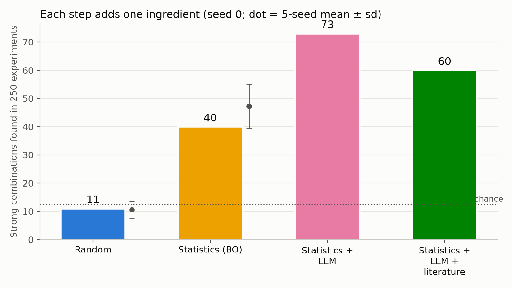
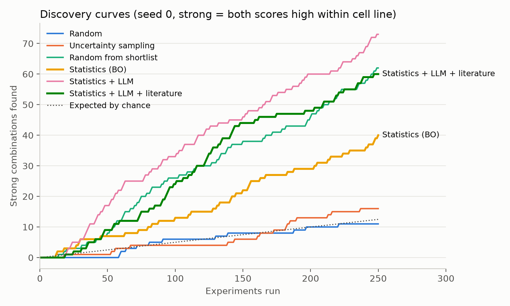

# Cancer-Combo-Agent: results for the Nov 13 meeting

Generated by `experiments/meeting_report.py`. Figures are in `results/backup/figures/`.

## The question
Can an LLM agent that reads the literature find strong cancer drug combinations in fewer experiments
than statistical methods? The O'Neil 2016 screen (38 drugs, 39 cancer cell lines, 22,737 experiments)
is used as a simulated lab: results stay hidden until a method "runs" an experiment. Each method gets
250 experiments (about 1.5% of the 16,907 it may choose from), in batches of 10. 10 cell lines are held
out entirely for the mechanism test.

## What counts as "strong" (agreed with the research team)
Top 10% Loewe synergy AND CSS (growth inhibition) above a cutoff, both ranked *within each cell line*,
tuned so 5.0% of experiments qualify. Within-line ranking stops a method from winning just by
picking generally drug-sensitive cell lines (with CSS alone, 5 lines hold 57% of top results).
Expected by chance in 250 picks: 12.5.

## The four-step ladder (main result)
Each step adds one ingredient. Same seed (0) and same first batch for every method.

| Method | Strong found (seed 0) | Across seeds |
|---|---|---|
| Random | 11 | 10.6 ± 2.9 (5 seeds) |
| Uncertainty sampling | 16 | 15.4 ± 3.4 (5 seeds) |
| Random from shortlist | 62 | 45.2 ± 13.4 (5 seeds) |
| Statistics (BO) | 40 | 47.2 ± 7.9 (5 seeds) |
| Statistics + LLM | 73 | 1 seed |
| Statistics + LLM + literature | 60 | 1 seed |

How to read this: the agent chooses from the model's 50-candidate shortlist, so the fair bar is **random picks from that same shortlist**. Across 5 seeds that control nearly matches BO (45.2 vs 47.2): the shortlist does most of the work. On seed 0 specifically, the shortlist control found 62 (a high draw) and BO 40 (a low draw). So on this seed the LLM without literature (73) beat every baseline, while the LLM with literature (60) roughly tied the shortlist control. With one run per agent arm and seed-to-seed sd of 8-13 for the baselines, these are promising but not yet conclusive; more seeds are needed before claiming the LLM adds value, or that literature hurts.

## The agent runs (real LLM)
Model: Claude Sonnet 5.5, effort medium, literature trimmed to 3 drug pairs x 2 papers per search per
round (budget: whole study under $30). Total API spend so far: $13.88
(both runs $13.80 + smoke test $0.07).

### Statistics + LLM + literature
- Cost: $8.04 for 81 LLM calls (2,558,135 input / 292,259 output tokens); retries 8; model(s) claude-sonnet-5-5
- Explanation levels of its 240 picks: {'mechanistic': 120, 'statistical': 102, 'cross_cancer': 18}; picks that fell back to BO order: 10
- Hypotheses proposed: 115; final status: {'dropped': 64, 'open': 26, 'supported': 20, 'refuted': 5}
- By drug familiarity: {'famous': '0 strong / 14 picked', 'mixed': '33 strong / 162 picked', 'obscure': '27 strong / 74 picked'}
- Held-out mechanism test: 32 mechanistic hypotheses scored on the 10 never-tested cell lines. Mean precision 0.75 vs 0.50 by guessing; mean response gap +0.153; permutation p < 0.001 (exploratory: 10 lines, one run; hypotheses overlap, so they are not independent and this p-value is optimistic).
- Example explanations:
  - **DINACICLIB + MK-8669 in T-47D** (round 2; strong): DINACICLIB + MK-8669 may give a high joint score in PI3K-pathway-activated lines (A2058, UACC62, MDAMB436, T-47D), as an untested mechanistic idea. The only support is general pharmacology (mTORC1 and CDK9 both lowering short-lived survival proteins such as MCL1), and the model predicts strongly negative scores. The BEZ-235 + DINACICLIB result in MDAMB436 is related but not direct evidence. | Why this experiment: T-47D (PIK3CA H1047R) tests the same DINACICLIB + MK-8669 idea in a PI3K-activated breast line, a different genotype and tissue from A2058. | Predicted responders: A2058, UACC62, MDAMB436, T-47D [sources: PMID:37104883]
  - **BEZ-235 + GEMCITABINE in LNCAP** (round 3; strong): BEZ-235 + GEMCITABINE will show a high joint score in LNCAP, the prostate line with PTEN loss, because PI3K/mTOR blockade should remove AKT-mediated tolerance of gemcitabine-induced replication stress. | Why this experiment: Tests whether the BEZ-235 + gemcitabine effect from A2058 carries over to PTEN-null LNCAP, where the model prediction is tightest (0.41, std 0.47). | Predicted responders: LNCAP [sources: none]
  - **BEZ-235 + PD325901 in A2058** (round 3; strong): BEZ-235 + PD325901 in A2058 is a candidate for a high joint score, since A2058 carries BRAF V600E and MAP2K1 P124S (MAPK-driven) together with PTEN loss, so dual MEK and PI3K/mTOR blockade should hit both survival pathways. | Why this experiment: Tests dual MEK plus PI3K/mTOR blockade in A2058, which has both BRAF/MAP2K1 and PTEN alterations. | Predicted responders: A2058 [sources: none]

### Statistics + LLM (no literature)
- Cost: $5.77 for 76 LLM calls (1,714,683 input / 233,614 output tokens); retries 3; model(s) claude-sonnet-5-5
- Explanation levels of its 240 picks: {'mechanistic': 148, 'statistical': 87, 'cross_cancer': 5}; picks that fell back to BO order: 0
- Hypotheses proposed: 107; final status: {'dropped': 67, 'open': 23, 'supported': 14, 'refuted': 3}
- By drug familiarity: {'famous': '8 strong / 34 picked', 'mixed': '28 strong / 136 picked', 'obscure': '37 strong / 80 picked'}
- Held-out mechanism test: 26 mechanistic hypotheses scored on the 10 never-tested cell lines. Mean precision 0.61 vs 0.50 by guessing; mean response gap +0.043; permutation p = 0.041 (exploratory: 10 lines, one run; hypotheses overlap, so they are not independent and this p-value is optimistic).
- Example explanations:
  - **BEZ-235 + GELDANAMYCIN in LNCAP** (round 1; strong): BEZ-235 + GELDANAMYCIN is an exploratory test in PTEN- or PIK3R1-altered lines (LNCAP, MDAMB436, A2058, UACC62). LNCAP (PTEN K6fs, PIK3R1 R639*) and MDAMB436 (PIK3R1 Y73*) are the most direct tests of PI3K dependence, with a low prior of a high joint score. | Why this experiment: LNCAP (PTEN and PIK3R1 lesions) is the most direct PI3K-dependence test, and it has high model uncertainty (std 0.78) so the result is informative. | Predicted responders: LNCAP, MDAMB436, A2058, UACC62 [sources: none]
  - **BEZ-235 + MK-8669 in UACC62** (round 3; strong): BEZ-235 + MK-8669 should give high joint scores in the shortlisted lines: the model predicts +0.54 to +0.57 with low std (0.42-0.47) in RKO, HCT116, OVCAR3, SK-OV-3, MSTO and UACC62. The pair already produced the top joint scores in LNCAP (0.99) and A2058 (0.78), both PTEN-altered. | Why this experiment: UACC62 (PTEN loss) is a PTEN-altered skin line like A2058, so it tests whether the high A2058 score generalizes. | Predicted responders: RKO, HCT116, OVCAR3, SK-OV-3, UACC62 [sources: none]
  - **BEZ-235 + MK-8669 in MSTO** (round 3; strong): BEZ-235 + MK-8669 should give high joint scores in the shortlisted lines: the model predicts +0.54 to +0.57 with low std (0.42-0.47) in RKO, HCT116, OVCAR3, SK-OV-3, MSTO and UACC62. The pair already produced the top joint scores in LNCAP (0.99) and A2058 (0.78), both PTEN-altered. | Why this experiment: MSTO has no panel PI3K driver, so it discriminates whether BEZ-235 + MK-8669 needs a PI3K lesion. | Predicted responders: RKO, HCT116, OVCAR3, SK-OV-3, UACC62 [sources: none]

## Supporting results
- Response model (random forest, 250 training experiments): rank accuracy 0.46
  (synergy) / 0.59 (inhibition); its uncertainty is calibrated
  (76% of values within 1 sd) but barely tracks errors for inhibition,
  which is why uncertainty sampling does poorly.
- Data checks: drug names matched by PubChem ID (38/38); cell-line genetics from Sanger Cell Model
  Passports (34/39 lines with mutation data; unknowns left unknown, never guessed).
- Leakage controls: the agent never sees hidden results, held-out lines, or the "strong" cutoffs;
  literature search excludes the O'Neil paper and synergy-prediction ML papers. All sanity checks pass.
- Built and ready but not yet run: no-critique and masked-drug-names ablations; more seeds.

## Limitations to say out loud
- One run per agent arm: suggestive, not conclusive.
- Cost grew during each run because the hypothesis list was never pruned (100+ hypotheses by the end;
  prompts grew from ~12k to ~43k tokens, and critique re-judged all of them every round). Runs cost
  $6-8 each; capping active hypotheses should bring that to ~$2-3, making 5 seeds of both arms ~$20-30.
- The mechanism test uses only 10 held-out lines: exploratory.
- PubMed abstracts stand in for SHELDON (access pending).

## Next steps
1. Cap the active hypothesis list (cost fix), then 5 seeds of both agent arms; then the no-critique
   and masked-names ablations.
2. Read explanations by hand for grounding; tune prompts if needed.
3. SHELDON if access arrives; paper draft and final slides.
